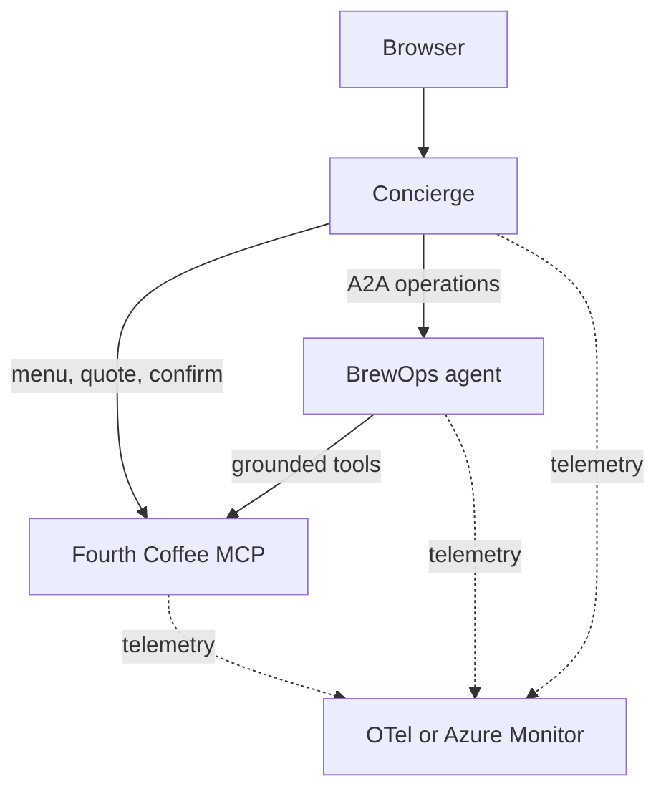

# Fourth Coffee

Fourth Coffee is a small MCP and A2A demo for distributed agent tracing. A browser concierge builds coffee orders, an operations agent checks inventory and fulfillment, and a deterministic MCP service owns the catalog, inventory, drafts, and submissions.

## Architecture



All three services come from one Python package and one container image. The `SERVICE` environment variable selects which one runs.

| Service             | Port | Responsibility                                       |
| ------------------- | ---: | ---------------------------------------------------- |
| `fourth-coffee-mcp` | 8101 | Menu, availability, quotes, and order submission     |
| `ops-agent`         | 8202 | Tool-grounded inventory and fulfillment decisions    |
| `concierge`         | 8301 | Browser, sessions, routing, drafts, and confirmation |

### How an order works

1. The concierge routes each message to menu, quote, operations, surprise, or general.
2. A quote creates a draft through the MCP `quote_order` tool. Quoting never reserves inventory.
3. The concierge asks the BrewOps agent to verify the draft can be made now.
4. Only the **Confirm** button calls `submit_order`. Chat messages never submit orders.

Drink sizes are **Single**, **Double**, and **Triple**, named for the number of espresso shots. Double is the default.

### Models

Both agents use an OpenAI-compatible Chat Completions endpoint, and the model must support `response_format` with `json_schema`. Plans are validated with Pydantic. Invalid output gets one retry with the validation errors; endpoint failures are reported, never treated as valid plans.

- **Concierge:** the model routes messages and writes replies. Without a model, or after two invalid plans, a deterministic router handles the demo prompts.
- **BrewOps:** the model turns free-form operations questions into an MCP tool plan. Specials and fulfillment checks from the concierge use structured requests and never call the model, so the agent still serves them when no model is configured.

### Specials and "surprise me"

Both use the same recipe from live inventory: a Double with the highest-stock coffee, milk, and two add-ons. If the top coffee has only one serving left, it uses the top two coffees instead.

- **Specials** recommend the drink only.
- **Surprise me** also quotes it and verifies fulfillment, so it is ready to confirm.

The recipe repeats until stock changes.

## Local quick start

You need Docker or Podman with Compose and [Ollama](https://ollama.com/) running on the host.

```bash
cp .env.example .env
ollama pull qwen3:8b
make up
```

Open [http://localhost:8301](http://localhost:8301) and try:

- `Show me the menu.`
- `Build me a double the daily with oat milk and chocolate shavings.`
- `Got any coffee specials tonight?`
- `Surprise me.`

Grafana is at [http://localhost:3000](http://localhost:3000) (admin/admin) with Tempo, Prometheus, and Loki already connected. Stop everything with `make down`.

## Development

You need Python 3.12 and [uv](https://docs.astral.sh/uv/).

| Command       | What it does                                                |
| ------------- | ----------------------------------------------------------- |
| `make sync`   | Install the locked development environment                  |
| `make check`  | Run ruff, format check, pyright, and pytest without changes |
| `make format` | Apply formatting                                            |
| `make build`  | Build the shared container image                            |

The image tag defaults to the version in `pyproject.toml`. Set `APP_VERSION` to override the version a running service reports.

## Kubernetes

The Helm chart deploys the same image three times. Validate it with:

```bash
helm lint deploy/helm/fourth-coffee
helm template fourth-coffee deploy/helm/fourth-coffee --namespace demo
```

### Local Kind

```bash
make kind-create   # build, create the cluster, and install the chart
make kind-delete   # uninstall and stop the observability stack
```

`make kind-create` starts the observability stack with Compose, creates a single-node Kind cluster, loads the image, and installs the chart with `deploy/helm/values-local.yaml`. The app is at [http://localhost:8301](http://localhost:8301).

In this profile all three pods share the node network and call each other over `127.0.0.1`. They reach Ollama and the OTel collector on the Docker host at `172.17.0.1`. If your Docker gateway differs, find it and pass it in:

```bash
docker inspect fourth-coffee-control-plane \
  --format '{{range .NetworkSettings.Networks}}{{.Gateway}}{{end}}'

make kind-create \
  OPENAI_BASE_URL=http://<gateway>:11434/v1 \
  OTEL_EXPORTER_OTLP_ENDPOINT=http://<gateway>:4318
```

See the [chart README](deploy/helm/fourth-coffee/README.md#local-kind-networking) for the full network path.

### Azure (AKS)

These Azure CLI commands create just enough Azure infrastructure to run the sample:

- A single-node AKS cluster with the OIDC issuer and workload identity enabled
- An Azure Container Registry, with the image built in the cloud (no local Docker needed)
- A Microsoft Foundry resource and project with `gpt-oss-120b`, a fast open-weight model that supports `json_schema` output
- Application Insights with native OTLP ingestion, so pods export straight to Azure Monitor without a collector
- Two managed identities: one for the agents (model and telemetry), one telemetry-only identity for the MCP service

You need the [Azure CLI](https://learn.microsoft.com/cli/azure/install-azure-cli), `kubectl` (`az aks install-cli`), and [Helm](https://helm.sh/docs/intro/install/). The commands use bash syntax, so run them from macOS, Linux, WSL, or [Azure Cloud Shell](https://shell.azure.com). The first `az monitor app-insights` command may prompt to install its CLI extension. In PowerShell, write variables as `$RG = "rg-fourth-coffee"` and replace the trailing `\` with a backtick.

**1. Set names.** `SUFFIX` makes the registry and Foundry names globally unique. Use only lowercase letters and numbers.

```bash
az login
SUFFIX=<your-unique-suffix>
RG=rg-fourth-coffee
LOCATION=eastus2
ACR=acrfc$SUFFIX
FOUNDRY=foundry-fc-$SUFFIX

az group create -n $RG -l $LOCATION
```

**2. Build the image and create the cluster.**

```bash
az acr create -g $RG -n $ACR --sku Basic
az acr build -r $ACR -t fourth-coffee:0.1.0 .

az aks create -g $RG -n aks-fourth-coffee \
  --node-count 1 \
  --enable-oidc-issuer \
  --enable-workload-identity \
  --attach-acr $ACR \
  --generate-ssh-keys
```

**3. Create the Foundry project and model.**

```bash
az cognitiveservices account create -g $RG -n $FOUNDRY -l $LOCATION \
  --kind AIServices --sku S0 --custom-domain $FOUNDRY \
  --allow-project-management --yes

az cognitiveservices account project create -g $RG -n $FOUNDRY \
  --project-name fourth-coffee -l $LOCATION

az cognitiveservices account deployment create -g $RG -n $FOUNDRY \
  --deployment-name gpt-oss-120b \
  --model-name gpt-oss-120b --model-version 1 --model-format OpenAI-OSS \
  --sku-name GlobalStandard --sku-capacity 50
```

**4. Create Application Insights with native OTLP.** Linking an Azure Monitor workspace through the `2025-01-23-preview` API is the CLI equivalent of the portal's **OTLP support: On**. Azure creates a managed data collection rule (DCR) and the OTLP endpoints.

```bash
az monitor log-analytics workspace create -g $RG -n log-fourth-coffee -l $LOCATION
az monitor account create -g $RG -n amw-fourth-coffee -l $LOCATION
az monitor app-insights component create -g $RG -a appi-fourth-coffee -l $LOCATION \
  --workspace log-fourth-coffee

AMW_ID=$(az monitor account show -g $RG -n amw-fourth-coffee --query id -o tsv)
az resource update -g $RG -n appi-fourth-coffee \
  --resource-type Microsoft.Insights/components --api-version 2025-01-23-preview \
  --set properties.AzureMonitorWorkspaceResourceId=$AMW_ID \
        properties.AzureMonitorWorkspaceIngestionMode=Enabled
```

**5. Create the workload identities.** The chart uses the `demo` ServiceAccount for the concierge and ops-agent and `fourth-coffee-mcp-telemetry` for the MCP service. Each identity trusts one of them.

```bash
OIDC_ISSUER=$(az aks show -g $RG -n aks-fourth-coffee --query oidcIssuerProfile.issuerUrl -o tsv)

az identity create -g $RG -n id-fourth-coffee
az identity federated-credential create -g $RG --identity-name id-fourth-coffee \
  -n demo --issuer $OIDC_ISSUER \
  --subject system:serviceaccount:demo:demo --audiences api://AzureADTokenExchange

az identity create -g $RG -n id-fourth-coffee-telemetry
az identity federated-credential create -g $RG --identity-name id-fourth-coffee-telemetry \
  -n fourth-coffee-mcp-telemetry --issuer $OIDC_ISSUER \
  --subject system:serviceaccount:demo:fourth-coffee-mcp-telemetry --audiences api://AzureADTokenExchange
```

**6. Grant access.** The agent identity can call the model and publish telemetry. The MCP identity can only publish telemetry.

```bash
APP_PRINCIPAL=$(az identity show -g $RG -n id-fourth-coffee --query principalId -o tsv)
TELEMETRY_PRINCIPAL=$(az identity show -g $RG -n id-fourth-coffee-telemetry --query principalId -o tsv)
FOUNDRY_ID=$(az cognitiveservices account show -g $RG -n $FOUNDRY --query id -o tsv)
DCR_ID=$(az resource show -g $RG -n appi-fourth-coffee \
  --resource-type Microsoft.Insights/components --api-version 2025-01-23-preview \
  --query properties.DataCollectionRuleResourceId -o tsv)

az role assignment create --assignee-object-id $APP_PRINCIPAL --assignee-principal-type ServicePrincipal \
  --role "Cognitive Services OpenAI User" --scope $FOUNDRY_ID
az role assignment create --assignee-object-id $APP_PRINCIPAL --assignee-principal-type ServicePrincipal \
  --role "Monitoring Metrics Publisher" --scope $DCR_ID
az role assignment create --assignee-object-id $TELEMETRY_PRINCIPAL --assignee-principal-type ServicePrincipal \
  --role "Monitoring Metrics Publisher" --scope $DCR_ID
```

**7. Deploy.** `values-azure.yaml` turns on workload identity and native OTLP. The `--set` flags fill in your resource values.

```bash
APP_CLIENT_ID=$(az identity show -g $RG -n id-fourth-coffee --query clientId -o tsv)
TELEMETRY_CLIENT_ID=$(az identity show -g $RG -n id-fourth-coffee-telemetry --query clientId -o tsv)
TRACES_ENDPOINT=$(az resource show -g $RG -n appi-fourth-coffee --resource-type Microsoft.Insights/components --api-version 2025-01-23-preview --query properties.OTLPTracesEndpoint -o tsv)
LOGS_ENDPOINT=$(az resource show -g $RG -n appi-fourth-coffee --resource-type Microsoft.Insights/components --api-version 2025-01-23-preview --query properties.OTLPLogsEndpoint -o tsv)
METRICS_ENDPOINT=$(az resource show -g $RG -n appi-fourth-coffee --resource-type Microsoft.Insights/components --api-version 2025-01-23-preview --query properties.OTLPMetricsEndpoint -o tsv)
INSTRUMENTATION_KEY=$(az resource show -g $RG -n appi-fourth-coffee --resource-type Microsoft.Insights/components --api-version 2025-01-23-preview --query properties.InstrumentationKey -o tsv)

az aks get-credentials -g $RG -n aks-fourth-coffee

helm upgrade --install fourth-coffee deploy/helm/fourth-coffee \
  --namespace demo --create-namespace \
  --values deploy/helm/values-azure.yaml \
  --set-string image.registry=$ACR.azurecr.io \
  --set-string image.tag=0.1.0 \
  --set-string workloadIdentity.clientId=$APP_CLIENT_ID \
  --set-string workloadIdentity.serviceAccounts.fourth-coffee-mcp.clientId=$TELEMETRY_CLIENT_ID \
  --set-string config.OPENAI_BASE_URL=https://$FOUNDRY.services.ai.azure.com/openai/v1/ \
  --set-string config.OPENAI_CHAT_MODEL=gpt-oss-120b \
  --set-string config.OTEL_EXPORTER_OTLP_TRACES_ENDPOINT=$TRACES_ENDPOINT \
  --set-string config.OTEL_EXPORTER_OTLP_LOGS_ENDPOINT=$LOGS_ENDPOINT \
  --set-string config.OTEL_EXPORTER_OTLP_METRICS_ENDPOINT=$METRICS_ENDPOINT \
  --set-string config.OTEL_RESOURCE_ATTRIBUTES=microsoft.applicationId=$INSTRUMENTATION_KEY \
  --wait

kubectl -n demo get service concierge
```

Open `http://<EXTERNAL-IP>` from the concierge service. Role assignments can take a few minutes to propagate. If the first chat fails with a 401 or 403, wait and try again.

**Clean up.** Delete everything when you're done:

```bash
az group delete -n $RG --yes --no-wait
```

#### Azure Monitor settings

The Azure profile sends traces, metrics, and logs straight to Azure Monitor's native OTLP endpoints. It does not need AKS application monitoring, an `Instrumentation` resource, or a collector pod.

The steps above supply the values `values-azure.yaml` leaves blank on purpose, so it never guesses a destination:

- The three `OTEL_EXPORTER_OTLP_*_ENDPOINT` values are the full HTTPS URLs from the Application Insights **OTLP Connection Info**.
- `OTEL_RESOURCE_ATTRIBUTES` is `microsoft.applicationId=<InstrumentationKey GUID>`. This is routing metadata, not a credential.

The profile already sets HTTP/protobuf, delta metrics, and exponential histograms.

With `OTEL_EXPORTER_OTLP_AUTH_MODE=workload_identity`, each pod uses its workload identity to get tokens for `https://monitor.azure.com/.default`, and Azure Identity refreshes them automatically. Use `default_credential` instead for a local process with existing Azure credentials, such as an Azure CLI login. Missing or invalid settings fail at startup. Authentication or export errors never fall back to classic ingestion.

The platform owns the Azure identities and role assignments; Helm only creates ServiceAccounts and annotations. Every exporting identity needs **Monitoring Metrics Publisher** on the application's DCR. The MCP service gets its own telemetry-only identity (`fourth-coffee-mcp-telemetry`), so it can appear in traces without getting model access.

To use the local collector or classic Application Insights exporter instead, set `OTEL_EXPORTER_OTLP_AUTH_MODE=none` and clear the native cloud endpoint values. In that mode, a traces endpoint takes priority over `APPLICATIONINSIGHTS_CONNECTION_STRING`. An Azure Monitor cloud URL without an authenticated mode is rejected.

**Verify ingestion.** A running pod does not prove that telemetry arrives. Send a chat, then find its trace and model call in `OTelSpans` in the Log Analytics workspace. Check again after the first token refresh. If export fails, check the pod logs:

- **401**: authentication
- **403**: the DCR publisher grant, or it hasn't propagated yet
- **404**: wrong URL or stream

Never print tokens while debugging. See [Azure Monitor native OTLP ingestion](https://learn.microsoft.com/azure/azure-monitor/containers/opentelemetry-protocol-ingestion) for details.

## AKS trace demo: a silent agent regression

The story: a prompt change ships, every health check stays green, and customers still get sensible answers. The only sign that the concierge got slower and more expensive is in its traces.

This fault is real, not simulated. During the AKS setup run, `gpt-oss-120b` occasionally broke the routing schema for specials, even with the normal prompt. The concierge retried and then fell back to the deterministic router, so the reply was still correct. The flag below makes that failure reliable enough to present.

Complete the [Azure (AKS)](#azure-aks) steps first.

### 1. Capture a baseline

Open the app and ask `Got any specials today?` and `Show me the menu.` a few times. In Application Insights, open **Search** (or **Transaction search**), pick a recent `concierge.chat` request, and open the end-to-end transaction. A healthy turn has:

- One `concierge.route` span with `concierge.router.outcome = model` and no events
- One model call (an HTTP `POST` to `/openai/v1/chat/completions`) under it
- For specials: the A2A call to `ops-agent`, then its MCP inventory call

### 2. Ship the regression

`CONCIERGE_ROUTER_PROMPT_VERSION=v2` swaps in a router prompt with one plausible edit: it treats specials as friendly conversation and sends them to `general`. That contradicts the `RoutingPlan` schema, which requires specials to use `route=operations`.

```bash
helm upgrade fourth-coffee deploy/helm/fourth-coffee \
  --namespace demo \
  --reuse-values \
  --set-string config.CONCIERGE_ROUTER_PROMPT_VERSION=v2 \
  --wait
```

To preview locally, set `CONCIERGE_ROUTER_PROMPT_VERSION=v2` in `.env` and run `make up`. Traces are in Grafana's Tempo view.

### 3. Notice that nothing looks wrong

Ask the same questions. The specials answer and the menu still look right. Pods are healthy, there are no HTTP errors, and AKS desktop shows nothing unusual. A dashboard might show latency creeping up, but nothing explains why.

### 4. Find it in the trace

Open the same kind of transaction again. Now the `concierge.route` span shows:

- One or two `structured_output.validation_failed` events with `error.message = specials requires route=operations`
- Two or three model calls instead of one
- Often `concierge.router.outcome = fallback`, meaning the model's routing was discarded and the heuristic router answered

In a sample run against `gpt-oss-120b`, every request hit at least one validation failure, and half of them exhausted both attempts and fell back. That included menu questions, so the regression spread beyond specials.

To quantify it across all traffic, run this in the Log Analytics workspace:

```kusto
OTelSpans
| where TimeGenerated > ago(30m)
| where Name == "concierge.route"
| summarize turns = count(), p95_ms = percentile(DurationMs, 95)
    by outcome = tostring(Attributes["concierge.router.outcome"]), bin(TimeGenerated, 5m)
| order by TimeGenerated asc
```

The `fallback` count and the p95 for `concierge.route` both jump at the moment of the upgrade.

The concierge logs also include a `Router validation exhausted` warning, but only the trace ties it to a specific customer turn, shows the wasted model calls, and shows which answers came from the fallback instead of the model.

### 5. Fix and verify

Roll back the prompt and check that traces return to one model call per turn with `outcome = model`:

```bash
helm upgrade fourth-coffee deploy/helm/fourth-coffee \
  --namespace demo \
  --reuse-values \
  --set-string config.CONCIERGE_ROUTER_PROMPT_VERSION=v1 \
  --wait
```

### Why this fault

Agent regressions rarely look like outages. Schema retries and safe fallbacks keep the experience working, which is the right design, but it also hides the cost: extra tokens, extra latency, and answers that no longer come from the model you think is serving them. The `concierge.route` span records the outcome and each validation failure, so you can see that cost per turn and across all traffic.

### Optional: capacity simulation

`ops-agent` can still simulate finite per-pod capacity with `config.OPS_DEMO_WORK_SECONDS` and `config.OPS_DEMO_CONCURRENCY` (default `0`, off). `scripts/load.py` drives fixed-concurrency specials traffic against the concierge. Only `ops-agent` can scale out, because the concierge and MCP service keep conversations, inventory, drafts, and idempotency keys in memory.

> [!important]
> This is a demo, not a production blueprint. Use synthetic data and restrict access. The concierge has no authentication.
