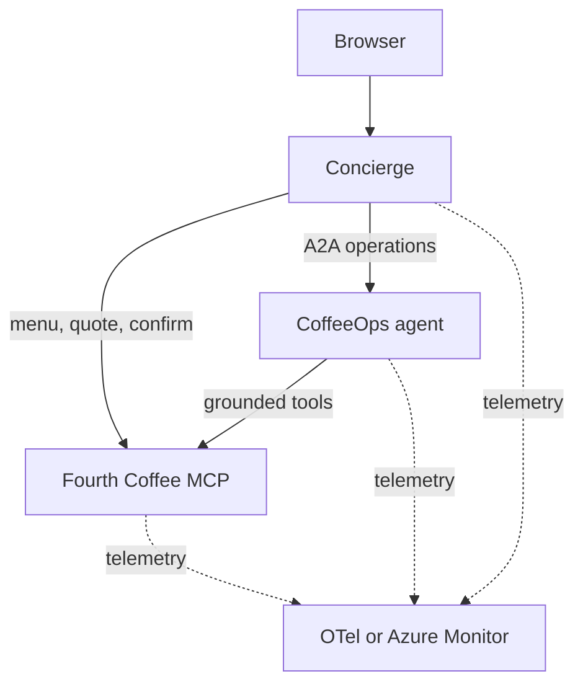

# Fourth Coffee

Fourth Coffee is a small MCP and A2A demo for distributed agent tracing. A browser concierge builds coffee orders, an operations agent checks inventory and fulfillment, and a deterministic MCP service owns the catalog, inventory, drafts, and submissions.

## Architecture



All three services come from one Python package and one container image. The `SERVICE` environment variable selects which one runs.

| Service             | Port | Responsibility                                       |
| ------------------- | ---: | ---------------------------------------------------- |
| `fourth-coffee-mcp` | 8101 | Menu, availability, quotes, and order submission     |
| `ops-agent`         | 8202 | Tool-grounded inventory and fulfillment decisions    |
| `concierge`         | 8301 | Browser, sessions, routing, drafts, and confirmation |

### How an order works

1. The concierge routes each message to menu, quote, operations, surprise, or general.
2. A quote creates a draft through the MCP `quote_order` tool. Quoting never reserves inventory.
3. The concierge asks the CoffeeOps agent to verify the draft can be made now.
4. Only the **Confirm** button calls `submit_order`. Chat messages never submit orders.

Drink sizes are **Single**, **Double**, and **Triple**, named for the number of espresso shots. Double is the default.

### Models

Both agents use an OpenAI-compatible Chat Completions endpoint, and the model must support `response_format` with `json_schema`. Plans are validated with Pydantic. Invalid output gets one retry with the validation errors; endpoint failures are reported, never treated as valid plans.

- **Concierge:** the model routes messages and writes replies. Without a model, or after two invalid plans, a deterministic router handles the demo prompts.
- **CoffeeOps:** the model turns free-form operations questions into an MCP tool plan. Specials and fulfillment checks from the concierge use structured requests and never call the model, so the agent still serves them when no model is configured.

### Specials and "surprise me"

Both use the same recipe from live inventory: a Double with the highest-stock coffee, milk, and two add-ons. If the top coffee has only one serving left, it uses the top two coffees instead.

- **Specials** recommend the drink only.
- **Surprise me** also quotes it and verifies fulfillment, so it is ready to confirm.

The recipe repeats until stock changes.

## Local quick start

You need Docker or Podman with Compose and [Ollama](https://ollama.com/) running on the host.

```bash
cp .env.example .env
ollama pull qwen3:8b
make up
```

Open [http://localhost:8301](http://localhost:8301) and try:

- `Show me the menu.`
- `Build me a double the daily with oat milk and chocolate shavings.`
- `Got any coffee specials tonight?`
- `Surprise me.`

Grafana is at [http://localhost:3000](http://localhost:3000) (admin/admin) with Tempo, Prometheus, and Loki already connected. Stop everything with `make down`.

## Development

You need Python 3.12 and [uv](https://docs.astral.sh/uv/).

| Command       | What it does                                                |
| ------------- | ----------------------------------------------------------- |
| `make sync`   | Install the locked development environment                  |
| `make check`  | Run ruff, format check, pyright, and pytest without changes |
| `make format` | Apply formatting                                            |
| `make build`  | Build the shared container image                            |

The image tag defaults to the version in `pyproject.toml`. Set `APP_VERSION` to override the version a running service reports.

## Kubernetes

The Helm chart deploys the same image three times. Validate it with:

```bash
helm lint deploy/helm/fourth-coffee
helm template fourth-coffee deploy/helm/fourth-coffee --namespace demo
```

### Local Kind

```bash
make kind-create   # build, create the cluster, and install the chart
make kind-delete   # uninstall and stop the observability stack
```

`make kind-create` starts the observability stack with Compose, creates a single-node Kind cluster, loads the image, and installs the chart with `deploy/helm/values-local.yaml`. The app is at [http://localhost:8301](http://localhost:8301).

In this profile all three pods share the node network and call each other over `127.0.0.1`. They reach Ollama and the OTel collector on the Docker host at `172.17.0.1`. If your Docker gateway differs, find it and pass it in:

```bash
docker inspect fourth-coffee-control-plane \
  --format '{{range .NetworkSettings.Networks}}{{.Gateway}}{{end}}'

make kind-create \
  OPENAI_BASE_URL=http://<gateway>:11434/v1 \
  OTEL_EXPORTER_OTLP_ENDPOINT=http://<gateway>:4318
```

See the [chart README](deploy/helm/fourth-coffee/README.md#local-kind-networking) for the full network path.

### Azure (AKS)

[aks-for-agents-with-hcp-tf-stacks](https://github.com/pauldotyu/aks-for-agents-with-hcp-tf-stacks) is an example Terraform setup. It provisions the cluster, Application Insights, workload identities, and federated credentials.

1. Fill in `deploy/helm/values-azure.yaml` using your Terraform outputs. See [Azure Monitor settings](#azure-monitor-settings) below.
2. Build and push an image to your registry.
3. Connect and install:

```bash
az aks get-credentials --resource-group <rg> --name <aks>

helm upgrade --install fourth-coffee deploy/helm/fourth-coffee \
  --namespace demo --create-namespace \
  --values deploy/helm/values-azure.yaml \
  --set-string image.tag=<your-image-tag>
```

#### Azure Monitor settings

The Azure profile sends traces, metrics, and logs straight to Azure Monitor's native OTLP endpoints. It does not need AKS application monitoring, an `Instrumentation` resource, or a collector pod.

In `values-azure.yaml`:

- Replace the example client IDs and model settings.
- Set the three `OTEL_EXPORTER_OTLP_*_ENDPOINT` values to the full HTTPS URLs from the Application Insights **OTLP Connection Info**.
- Set `OTEL_RESOURCE_ATTRIBUTES` to `microsoft.applicationId=<InstrumentationKey GUID>`. This is routing metadata, not a credential.

The profile ships with these values blank on purpose, so it never guesses a destination. It already sets HTTP/protobuf, delta metrics, and exponential histograms.

With `OTEL_EXPORTER_OTLP_AUTH_MODE=workload_identity`, each pod uses its workload identity to get tokens for `https://monitor.azure.com/.default`, and Azure Identity refreshes them automatically. Use `default_credential` instead for a local process with existing Azure credentials, such as an Azure CLI login. Missing or invalid settings fail at startup. Authentication or export errors never fall back to classic ingestion.

The platform owns the Azure identities and role assignments; Helm only creates ServiceAccounts and annotations. Grant **Monitoring Metrics Publisher** on the application's DCR to every exporting identity. The MCP service gets its own telemetry-only identity (`fourth-coffee-mcp-telemetry`), so it can appear in traces without getting model access.

To use the local collector or classic Application Insights exporter instead, set `OTEL_EXPORTER_OTLP_AUTH_MODE=none` and clear the native cloud endpoint values. In that mode, a traces endpoint takes priority over `APPLICATIONINSIGHTS_CONNECTION_STRING`. An Azure Monitor cloud URL without an authenticated mode is rejected.

**Verify ingestion.** A running pod does not prove that telemetry arrives. Send a chat, then find its trace and model call in `OTelSpans` in the Log Analytics workspace. Check again after the first token refresh. If export fails, check the pod logs:

- **401**: authentication
- **403**: the DCR publisher grant, or it hasn't propagated yet
- **404**: wrong URL or stream

Never print tokens while debugging. See [Azure Monitor native OTLP ingestion](https://learn.microsoft.com/azure/azure-monitor/containers/opentelemetry-protocol-ingestion) for details.

## AKS scaling demo

The story: run locally, deploy to AKS, then use AKS desktop to find and fix a capacity bottleneck in the CoffeeOps agent. Provision the cluster, registry access, model access, and developer permissions before presenting.

If you plan to generate the Dockerfile and Helm chart live with AKS dev tools, use a separate starter checkout without them. Keep this repo's versions as the known-good fallback.

### 1. Simulate limited capacity

`ops-agent` can simulate finite per-pod capacity. With the settings below, each pod handles two requests at a time and each takes one second. Requests still travel the real concierge → A2A → MCP path, so this shows agent-service queueing, not model speed.

```bash
helm upgrade --install fourth-coffee deploy/helm/fourth-coffee \
  --namespace demo --create-namespace \
  --values deploy/helm/values-azure.yaml \
  --set-string image.tag=<your-image-tag> \
  --set-string config.OPS_DEMO_WORK_SECONDS=1 \
  --set-string config.OPS_DEMO_CONCURRENCY=2 \
  --set components.opsAgent.replicas=1 \
  --wait
```

To preview locally, set `OPS_DEMO_WORK_SECONDS=1` in `.env` and run `make up`. `0` (the default) turns the simulation off. Use AKS for the real demo, not the single-node Kind profile.

### 2. Take model latency out of the measurement (optional)

For repeatable numbers, turn off the concierge model so it uses the deterministic router. Specials then make no model calls at all. This restarts the concierge and clears its conversations, so finish any open orders first.

```bash
kubectl -n demo set env deployment/concierge OPENAI_BASE_URL= OPENAI_CHAT_MODEL=
kubectl -n demo rollout status deployment/concierge
```

With the model on, the measured latency also includes routing inference.

### 3. Measure, scale, repeat

1. Open the app and ask `Got any specials today?`.
2. In AKS desktop, open the `demo` namespace (or import it as a Project) and look at the three workloads and the `ops-agent` logs.
3. Run the load test against the concierge. Each request is a new session asking for specials; it never quotes or submits orders.

   ```bash
   uv run python scripts/load.py --url http://<concierge-address> \
     --requests 120 --concurrency 12
   ```

4. While it runs, watch the `ops-agent` logs for `queue_wait_ms`, `processing_ms`, `pod`, and `outcome`. Use `trace_id` to jump to the distributed trace. Queued work doesn't need high CPU to be slow.
5. Scale **only `ops-agent`** from 1 to 3 replicas in AKS desktop. When all pods are ready, rerun the same command. Look for traffic across all three pods, less queueing, and lower p95 latency.

The load script prints JSON with requests per second, p50/p95 latency (successful requests only), and failure count. Any failure makes it exit nonzero. For a fair comparison, use runs with zero failures, the same settings, and no rollout in progress. This is fixed-concurrency load, not a fixed arrival rate.

### 4. Reset

```bash
kubectl -n demo set env deployment/concierge OPENAI_BASE_URL- OPENAI_CHAT_MODEL-
kubectl -n demo scale deployment/ops-agent --replicas=1
```

To turn off the simulation, redeploy with `config.OPS_DEMO_WORK_SECONDS="0"`. A Helm upgrade also resets replica counts to the chart values.

### Why only ops-agent scales

The concierge and MCP service keep conversations, inventory, drafts, and idempotency keys in memory, so keep them at **one replica**. `ops-agent` is stateless per request. The concierge starts a fresh A2A task for every call and doesn't reuse idle connections, so new requests spread across all `ops-agent` pods.

> [!important]
> This is a demo, not a production blueprint. Use synthetic data and restrict access. The concierge has no authentication.
